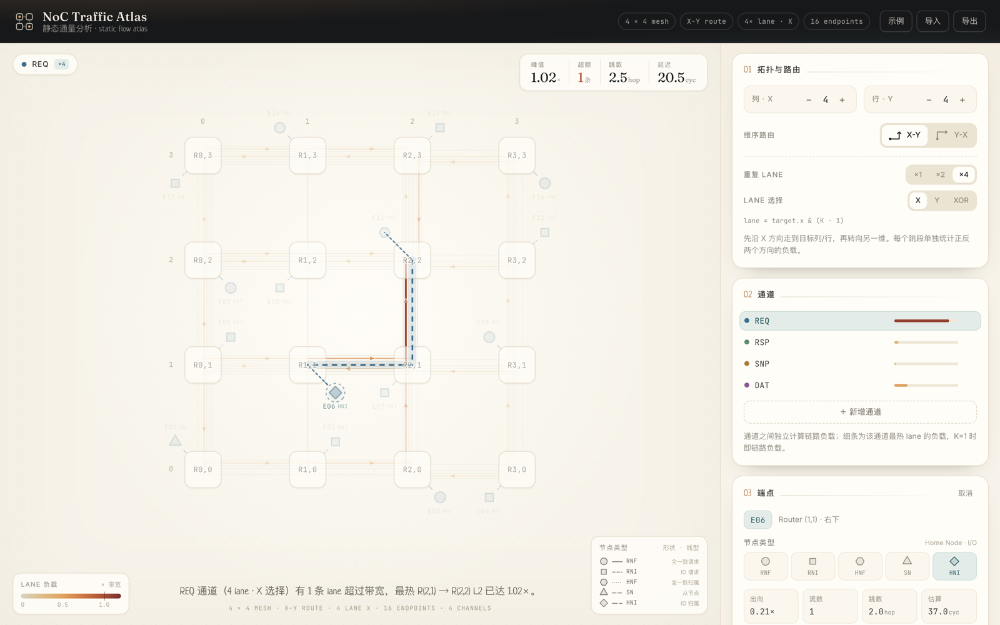

# NoC Traffic Atlas

面向 Mesh NoC 的**静态流量分析工作台**：手写或导入一份流量矩阵，立刻看到每条链路的负载、瓶颈位置和平均路由代价。纯前端、零后端，打开即用。

**在线访问：<https://celestial-42.github.io/noc_static_sim/>**



## 功能

- **Mesh 拓扑**：1×1 ～ 12×12，每个 Router 最多挂 4 个端点，原点在左下角，符合 NoC 习惯。
- **维序路由**：X-Y / Y-X 两种维度顺序，逐跳沿最短路走到目标。
- **多通道**：内置 REQ / RSP / SNP / DAT，可增删通道；每个通道独立统计链路负载。
- **每通道多流**：一个端点在一个通道上可以同时向多个目标注入流量，适合 fan-out / 多播式的近似建模。
- **duplicate lane**：每条物理链路可配置 ×1 / ×2 / ×4 条并行 lane，lane 选择支持 `X`（target xid bit0）、`Y`（target yid bit0）、`XOR`（src^tgt 均匀异或），画布上逐条 lane 着色。
- **可视化**：链路按负载着色加粗，方向箭头独立图层；悬停查看链路双向负载、每条 lane 的明细、端点各通道注入与路由预览。
- **瓶颈榜**：按单向 lane 负载排序，直接给出最热的若干条链路。
- **缩放与平移**：滚轮以光标为锚点缩放，拖动平移，双击复位。
- **导入 / 导出**：JSON 配置一键导出，可再次导入复现（兼容早期 v1/v2 文件）。

## 快速开始

```bash
npm install
npm run dev      # 开发服务器
npm run build    # 产出 dist/
npm run preview  # 预览构建结果
```

## 画布交互

| 操作 | 效果 |
| --- | --- |
| 点击 Router | 选中该 Router；空白槽位显示 `+`，可直接添加端点 |
| 悬停 Router / 端点 / 链路 | 浮动卡片显示该处负载；相关链路保持高亮 |
| 滚轮 | 以光标为锚点缩放（0.6× ～ 4×） |
| 按住拖动 | 平移画布；拖动不会误触发选中 |
| 双击画布 / 点击右下角 `xx% · 复位` | 恢复正常视图 |
| `Esc` | 取消选中 |

右侧面板从上到下依次是：拓扑与路由、通道列表、所选对象编辑、瓶颈榜。

## 流量模型

- 每个端点每个通道可以有多条流，每条流有独立的目标和注入率；注入率以「一条链路带宽」为单位。
- 流按配置的维序路由逐跳前进，每经过一条单向链路就在该方向上累加一次负载。
- **duplicate lane**：一条流在整个路由过程中固定走同一条 lane，重复 lane 的收益体现在单条 lane 的负载上。

lane 选择规则（K 为每条链路的 lane 数，`& (K-1)` 取低位）：

| 方式 | 公式 |
| --- | --- |
| `X` | `lane = target.x & (K − 1)` |
| `Y` | `lane = target.y & (K − 1)` |
| `XOR` | `lane = (tx ^ ty ^ sx ^ sy) & (K − 1)` |

### 指标口径

- **峰值负载**：当前通道所有单向 lane 中最大的负载，链路颜色、粗细、方向箭头与瓶颈榜都按这个值绘制。
- **超额**：负载超过 `1.0×` 的单条 lane 数量；K=1 时即超额链路数。
- **跳数**：按注入率加权的平均路由跳数。
- **延迟**：每跳 `2` 个流水周期，叠加 M/M/1 排队项 `load / (1 − load)`（load 上限 0.97），再按注入率加权平均。

## 配置格式

导出的 JSON 为 `version: 3`：

```json
{
  "version": 3,
  "cols": 4,
  "rows": 4,
  "routing": "xy",
  "lanes": { "count": 2, "axis": "xor" },
  "channels": [{ "id": "REQ", "color": "#3C6E8F" }],
  "endpoints": [
    {
      "id": 1,
      "x": 0,
      "y": 0,
      "slot": 0,
      "flows": {
        "REQ": [
          { "target": 3, "rate": 0.4 },
          { "target": 4, "rate": 0.2 }
        ]
      }
    }
  ]
}
```

- `lanes.count` 取值 1 / 2 / 4（超出会归一到 4），`lanes.axis` 为 `xid` / `yid` / `xor`。
- v1/v2 的 `target` / `inject` 字段在导入时自动转换为单条流。

## 部署

`main` 分支的推送会通过 GitHub Actions（`.github/workflows/deploy.yml`）构建并发布到 GitHub Pages：

<https://celestial-42.github.io/noc_static_sim/>

构建使用相对路径（`base: './'`），所以同一个 `dist/` 也可以直接放在任意静态服务器的子目录下。

首次部署需要在仓库 **Settings → Pages → Build and deployment → Source** 中选中 **GitHub Actions**（这一步需要仓库管理员权限，Actions 内置 token 无法代劳）。之后每次推送 `main` 都会自动构建并发布。

## 技术栈

Vite + Svelte 5（runes）+ D3（色标与插值）。无框架后端，全部计算在浏览器内完成。

```
src/
  App.svelte              页面骨架、状态与导入导出
  lib/model.js            拓扑、维序路由、lane 选择与静态负载分析
  lib/MeshStage.svelte    画布：链路 / 箭头 / 路由预览 / 缩放平移
  lib/TopologyCard.svelte 尺寸、维序、lane 配置
  lib/ChannelCard.svelte  通道列表与各通道峰值负载
  lib/Inspector.svelte    选中对象的详情与流量编辑
  lib/BottleneckCard.svelte 瓶颈榜
  lib/theme.js            负载色标与线宽
```
